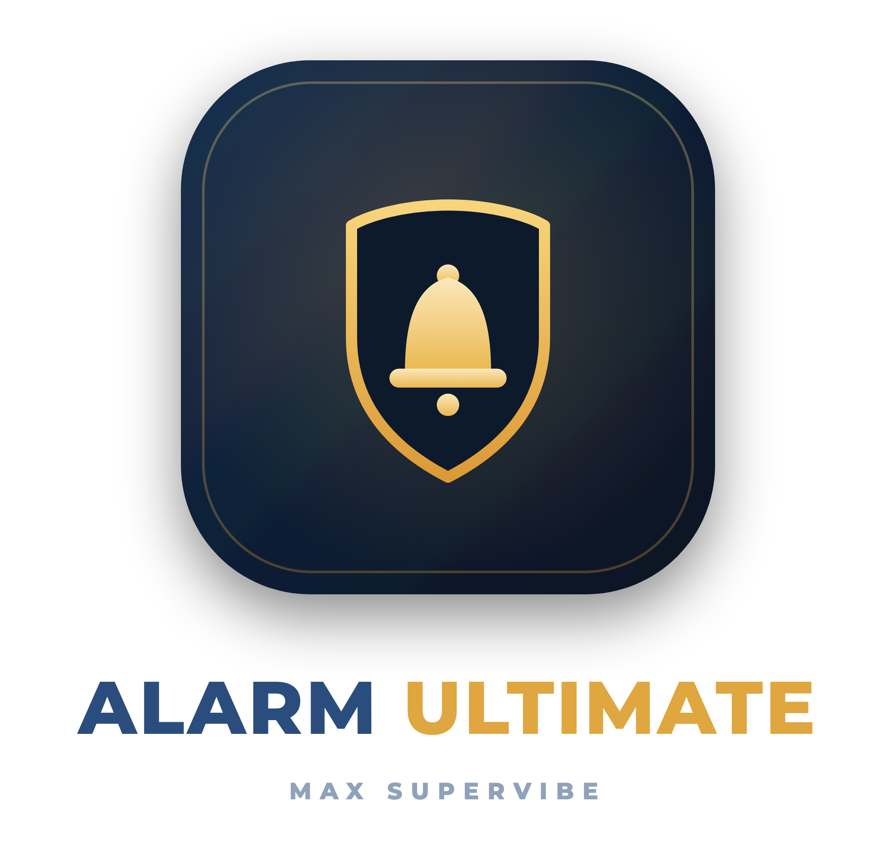

  

## A complete **alarm system** for Node-RED, with a ready-to-use **web control panel**.

Create zones, arm/disarm with optional code, entry/exit delays, bypass, chime, panic, siren, 24h/fire/tamper zones and an event log — all configured from a friendly editor, no programming required.
 
 
 

[![NPM version][npm-version-image]][npm-url]
[![NPM downloads][npm-downloads-image]][npm-url]
[![Node-RED Flows][flows-image]][flows-url]
[![License][license-image]][license-url]
[![GitHub issues][issues-image]][issues-url]

  

  <a href="https://youtube.com/playlist?list=PL9Yh1bjbLAYrybBZKykfKLDrRAspj9to4&si=j0mLqVMBcHKjBpNY">▶ Watch the Alarm Ultimate video playlist on YouTube</a>

### Works great with

  
  &nbsp;&nbsp;&nbsp;
  

Built‑in **Home Assistant** and **MQTT** support: the alarm can appear in Home Assistant automatically (alarm panel + a sensor per zone) without writing any configuration. See [Home Assistant & MQTT](#home-assistant--mqtt).

## 📘 Documentation

The full documentation is on **[maxsupervibe.com](https://www.maxsupervibe.com/docs/alarm-ultimate/)**, together with the help of every other Max Supervibe node.

  <a href="https://www.maxsupervibe.com/docs/alarm-ultimate/">📘 Go to the documentation</a>

Release notes: [CHANGELOG.md](CHANGELOG.md)

[repo-url]: https://github.com/Supergiovane/node-red-contrib-alarm-ultimate
[npm-url]: https://www.npmjs.com/package/node-red-contrib-alarm-ultimate
[flows-url]: https://flows.nodered.org/node/node-red-contrib-alarm-ultimate
[license-url]: LICENSE
[issues-url]: https://github.com/Supergiovane/node-red-contrib-alarm-ultimate/issues
[npm-version-image]: https://img.shields.io/npm/v/node-red-contrib-alarm-ultimate.svg
[npm-downloads-image]: https://img.shields.io/npm/dm/node-red-contrib-alarm-ultimate.svg
[flows-image]: https://img.shields.io/badge/Node--RED%20Flows-library-8f0000?logo=nodered&logoColor=white
[license-image]: https://img.shields.io/npm/l/node-red-contrib-alarm-ultimate.svg
[issues-image]: https://img.shields.io/github/issues/Supergiovane/node-red-contrib-alarm-ultimate.svg
